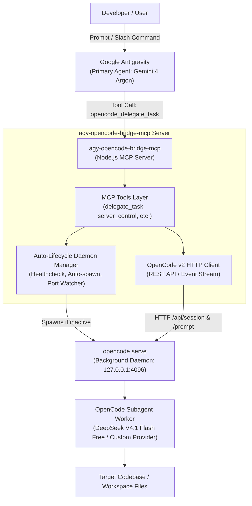

# ARCHITECTURE.md — System Design & OpenCode API Contract

## 1. High-Level System Architecture

`agy-opencode-bridge-mcp` connects Google Antigravity to local OpenCode subagents via the Model Context Protocol (MCP) and OpenCode's v2 REST HTTP daemon.



---

## 2. Directory Layout

```text
agy-opencode bridge mcp/
├── src/
│   ├── index.js              # MCP Server entrypoint (Stdio JSON-RPC 2.0 transport)
│   ├── opencode-client.js    # OpenCode v2 HTTP Client & Auto-Lifecycle Process Manager
│   └── tools.js              # Tool definitions & execution dispatchers
├── skills/
│   └── opencode-bridge/
│       └── SKILL.md          # Antigravity skill definition & interactive gate
├── commands/
│   └── opencode.md           # Slash command /opencode definition
├── install.ps1               # Windows PowerShell installer & MCP registrar
├── install.sh                # Linux / macOS / WSL Bash installer & MCP registrar
├── AGENTS.md                 # Operational constraints & agent boundaries
├── ARCHITECTURE.md           # System design & HTTP API contract (this file)
├── KNOWN_ISSUES.md           # Upstream quirks, ports & sandbox limitations
├── TASK_MEMORY.md            # Lean state snapshot (<40 lines)
├── LICENSE                   # MIT License (c) 2026 Ali Özdaş
├── README.md                 # Comprehensive user & developer guide
└── package.json              # Node.js project manifest
```

---

## 3. Auto-Lifecycle Process Manager (`opencode serve`)

The bridge eliminates manual daemon management using an autonomous supervisor:

1. **Port & Health Probing**:
   - Before dispatching any request, the bridge performs an HTTP probe to `http://127.0.0.1:<port>/api/info` with a 1500ms timeout.
   - If a 200 OK response with `{ status: "ok" }` or `{ version: ... }` is received, the daemon is active and reused.
2. **Auto-Spawn**:
   - If the health check fails or times out, the bridge launches `opencode serve --port 4096 --hostname 127.0.0.1` as an unattached background process (detached stdio).
   - The daemon PID is persisted to a local state lockfile (`.opencode-serve.pid`).
3. **Readiness Verification**:
   - The manager polls `GET /api/info` with exponential backoff (100ms, 200ms, 400ms, 800ms) up to a 15-second cutoff until the daemon reports ready.
4. **Lifecycle Control**:
   - Supports graceful shutdown (`SIGTERM` / `SIGINT`) and forced recovery (`action: "restart"` via `opencode_server_control`).

---

## 4. OpenCode v2 HTTP API Contract

The bridge interfaces directly with OpenCode's v2 REST API running on `127.0.0.1:4096`:

### `GET /api/info`
Returns daemon metadata, version, and health status.
- **Request**: `GET /api/info`
- **Response**:
  ```json
  {
    "version": "1.2.0",
    "platform": "win32",
    "status": "ready"
  }
  ```

### `GET /api/model`
Enumerates configured model providers and models available to OpenCode.
- **Request**: `GET /api/model`
- **Response**:
  ```json
  [
    {
      "id": "deepseek-v4.1-flash-free",
      "name": "DeepSeek V4.1 Flash Free",
      "provider": "opencode",
      "free": true
    },
    {
      "id": "claude-3-7-sonnet",
      "name": "Claude 3.7 Sonnet",
      "provider": "openrouter",
      "free": false
    }
  ]
  ```

### `POST /api/session`
Initializes a new isolated OpenCode conversation session.
- **Request**:
  ```json
  {
    "cwd": "G:\\Github\\target-project",
    "title": "Subagent Refactor Task"
  }
  ```
- **Response**:
  ```json
  {
    "id": "ses_019294a8-6b82-7fd1-9f21-99884511ab22",
    "createdAt": "2026-10-24T20:30:00Z"
  }
  ```

### `POST /api/session/{id}/prompt`
Executes a task prompt within the specified session.
- **Request**:
  ```json
  {
    "text": "Refactor auth middleware to support Bearer tokens with unit tests.",
    "provider": "opencode",
    "model": "deepseek-v4.1-flash-free",
    "variant": "default",
    "autoApprove": true
  }
  ```
- **Response**:
  ```json
  {
    "status": "completed",
    "message": "Auth middleware successfully updated. 4 tests passing.",
    "toolsUsed": ["read_file", "write_file", "run_command"]
  }
  ```

### `GET /api/session/{id}/message`
Retrieves message history and tool execution logs for audit and multi-turn context inspection.
- **Request**: `GET /api/session/{id}/message?limit=50`
- **Response**:
  ```json
  {
    "messages": [
      { "role": "user", "content": "Refactor auth middleware..." },
      { "role": "assistant", "content": "I will examine the existing auth files..." }
    ]
  }
  ```

### `POST /api/session/{id}/abort`
Cancels any long-running or stalled execution within the given session.
- **Request**: `POST /api/session/{id}/abort`
- **Response**: `{ "aborted": true }`
